<div align="center">

# 📱 CRUDNative

**Belajar CRUD & React Native dari nol, dalam Bahasa Indonesia.**

Mulai dari JavaScript dasar → bikin API & database → bangun aplikasi HP yang tersambung ke API buatanmu sendiri.

[](https://nextjs.org)
[](https://expo.dev)
[](https://expressjs.com)
[](https://prisma.io)
[](https://nodejs.org)
[](LICENSE)
[](LICENSE-CONTENT.md)

<br/>

[](https://crudnative.netlify.app/)
[](https://crudnative.netlify.app/)

[Preview](#-preview) · [Daftar Bab](#-daftar-bab) · [Mulai Cepat](#-mulai-cepat) · [Deploy](#-deploy-ke-netlify) · [Lisensi](#-lisensi)

<br/>

<a href="https://crudnative.netlify.app/">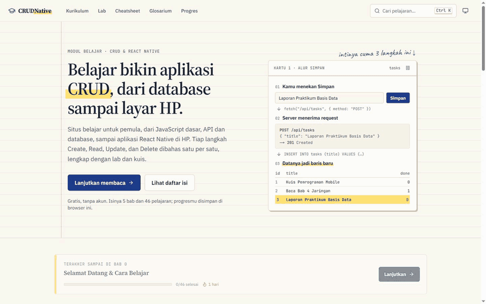</a>

</div>

---

## ✨ Sekilas

| 📚 Bab | 📝 Pelajaran | ⏱️ Durasi | 🧪 Lab | 📄 Cheatsheet | 📖 Glosarium |
| :---: | :---: | :---: | :---: | :---: | :---: |
| **5** | **46** | **~28 jam** | **6** | **8** | **137 istilah** |

- 🌐 **Jalan di browser**: materi, kuis, dan lab interaktif tanpa instalasi.
- 📱 **Ramah HP**: nyaman dibuka di HP maupun laptop.
- 💾 **Tanpa akun**: progres belajar tersimpan di browser.
- 🛠️ **Langsung praktik**: sepanjang materi kamu membangun proyek latihan **"Tugas & Catatan Kuliah"**. Polanya bisa dipakai untuk aplikasi CRUD apa pun.

## 👀 Preview

Klik tiap bagian untuk melihat animasi tampilan **desktop** 🖥️ dan **mobile** 📱.

> [!NOTE]
> Data di preview adalah **progres contoh** (23/46 pelajaran, streak 14 hari) agar fitur terlihat. Saat pertama dibuka, progresmu mulai dari nol.

<details open>
<summary><b>🏠 Beranda</b> · <a href="https://crudnative.netlify.app/">buka</a></summary>

<br/>

✨ Animasi **alur simpan** data · tombol **Lanjutkan** ke pelajaran terakhir · pencarian <kbd>Ctrl</kbd>+<kbd>K</kbd> · **mode gelap** · menu mobile.


| 🖥️ Desktop | 📱 Mobile |
| :---: | :---: |
|  | 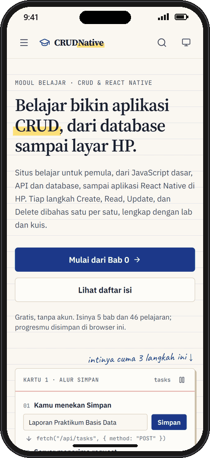 |

</details>

<details>
<summary><b>📚 Kurikulum</b> · <a href="https://crudnative.netlify.app/belajar/">buka</a></summary>

<br/>

✨ Bar **progres** keseluruhan · tanda ✔️ pelajaran selesai · **kuis akhir bab** · sidebar bab yang bisa dilipat.


| 🖥️ Desktop | 📱 Mobile |
| :---: | :---: |
| 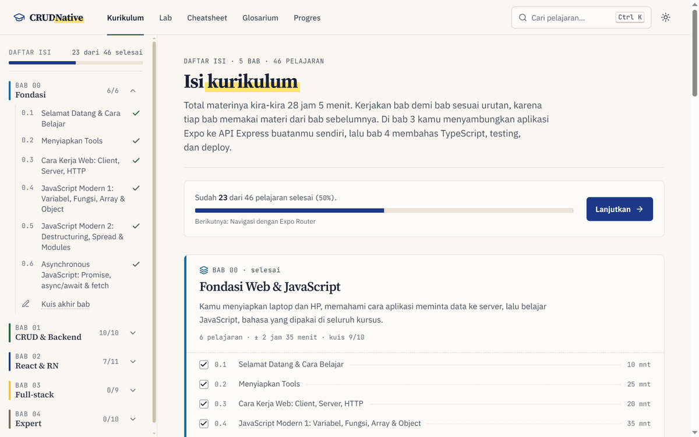 | 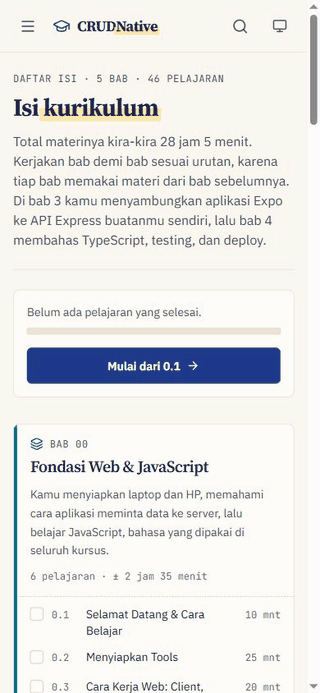 |

</details>

<details>
<summary><b>📝 Halaman Pelajaran</b> · <a href="https://crudnative.netlify.app/belajar/fondasi/selamat-datang/">buka</a></summary>

<br/>

✨ Tab kode per **perangkat** · tombol **salin kode** · **petunjuk bertahap** · kuis dengan **pembahasan** · tandai **selesai**.


| 🖥️ Desktop | 📱 Mobile |
| :---: | :---: |
| 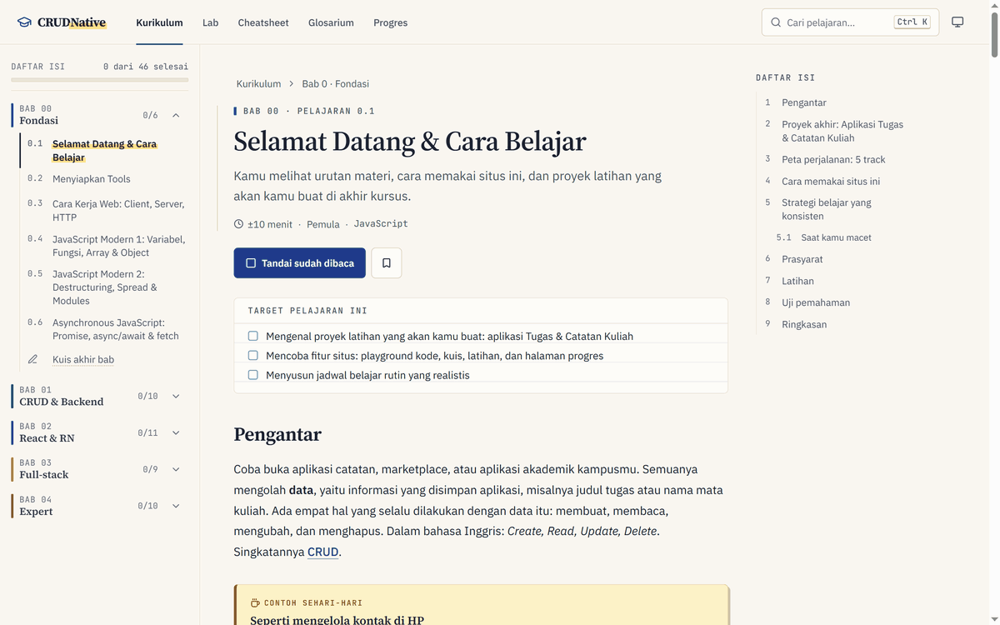 | 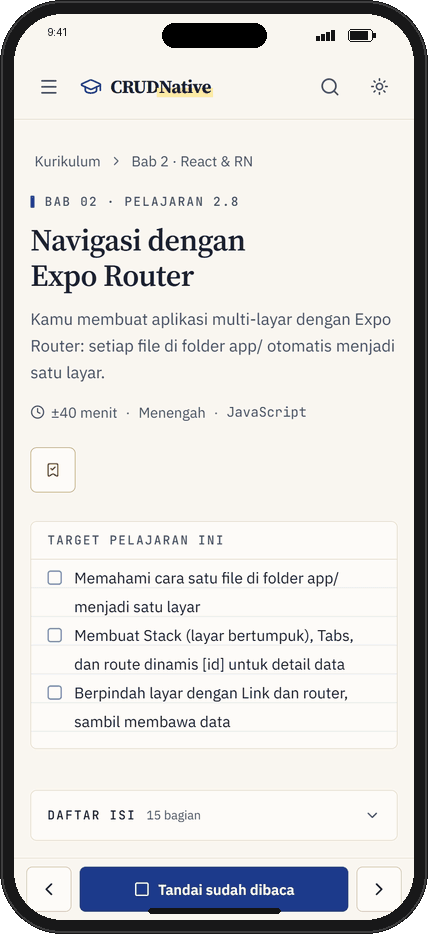 |

</details>

<details>
<summary><b>🧪 Lab Interaktif</b> · <a href="https://crudnative.netlify.app/lab/">buka</a></summary>

<br/>

✨ Simulator **CRUD** langsung: tambah, ubah, hapus data lalu lihat **Request → SQL → Response** dan isi **tabel database** berubah real-time.


| 🖥️ Desktop | 📱 Mobile |
| :---: | :---: |
| 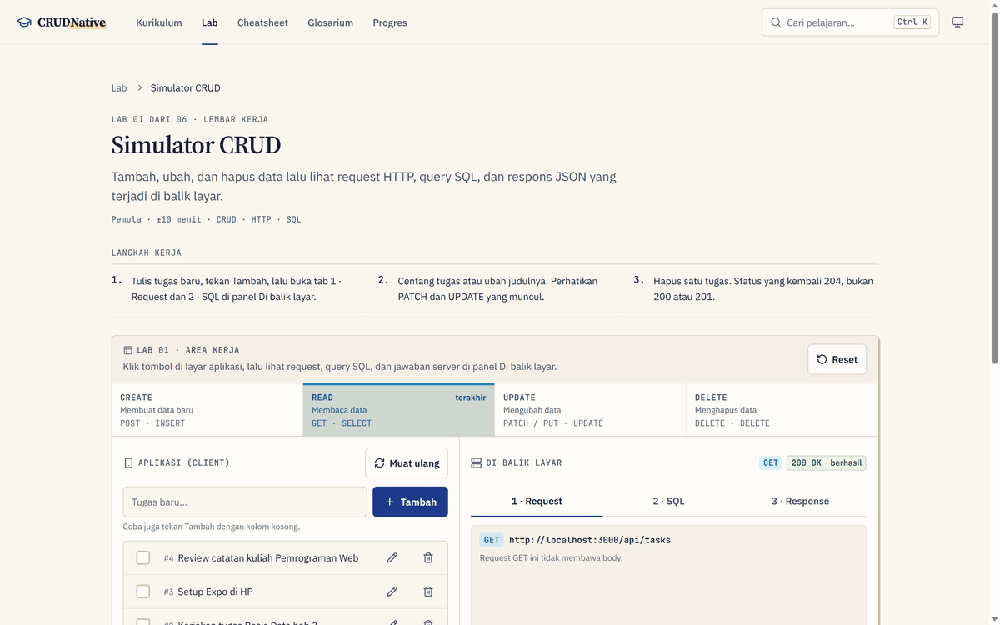 | 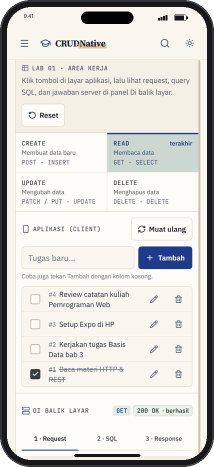 |

</details>

<details>
<summary><b>📄 Cheatsheet</b> · <a href="https://crudnative.netlify.app/cheatsheet/">buka</a></summary>

<br/>

✨ **Daftar isi** cepat · tab **INNER / LEFT JOIN** & **INSERT / UPDATE** · tombol salin · **cetak ke PDF**.


| 🖥️ Desktop | 📱 Mobile |
| :---: | :---: |
| 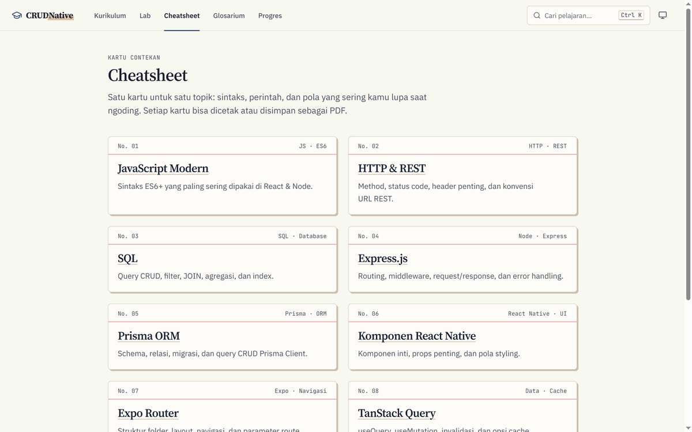 | 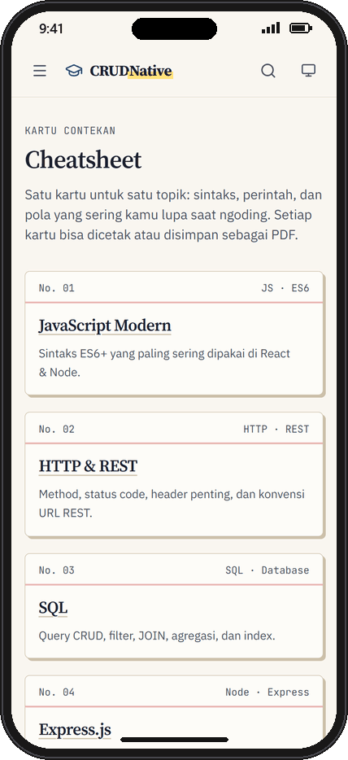 |

</details>

<details>
<summary><b>📖 Glosarium</b> · <a href="https://crudnative.netlify.app/glosarium/">buka</a></summary>

<br/>

✨ **Cari istilah** instan · **filter kategori** · penjelasan singkat berbahasa Indonesia.


| 🖥️ Desktop | 📱 Mobile |
| :---: | :---: |
| 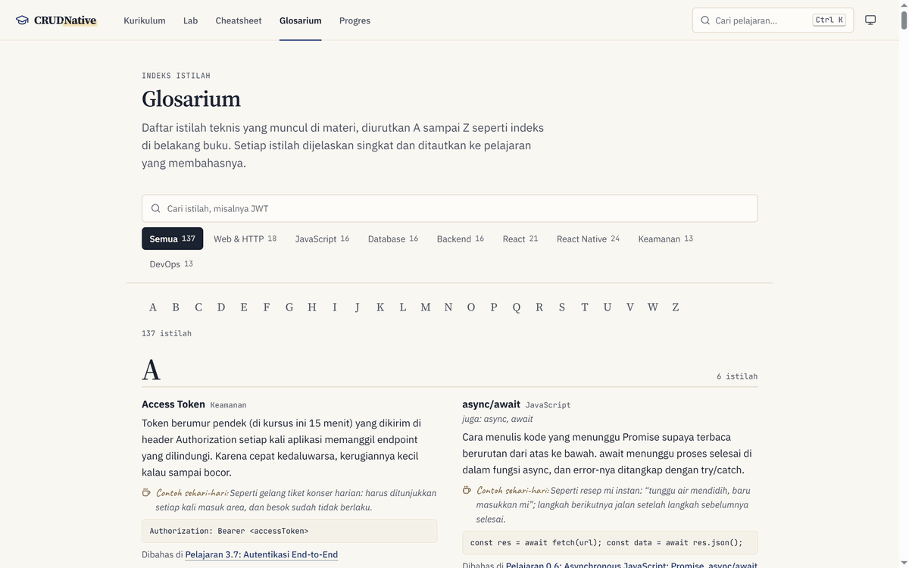 | 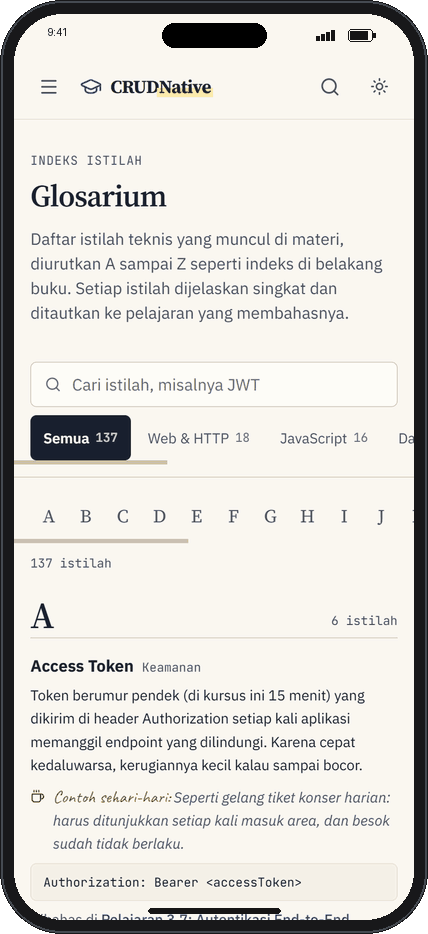 |

</details>

<details>
<summary><b>📊 Progres Belajar</b> · <a href="https://crudnative.netlify.app/progres/">buka</a></summary>

<br/>

✨ **Heatmap** hari belajar & streak · progres **per bab** · **cap prestasi** · riwayat **nilai kuis** · pelajaran ditandai · **ekspor / impor** progres.


| 🖥️ Desktop | 📱 Mobile |
| :---: | :---: |
| 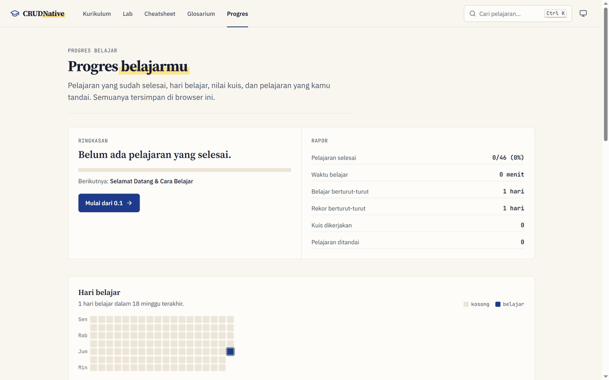 | 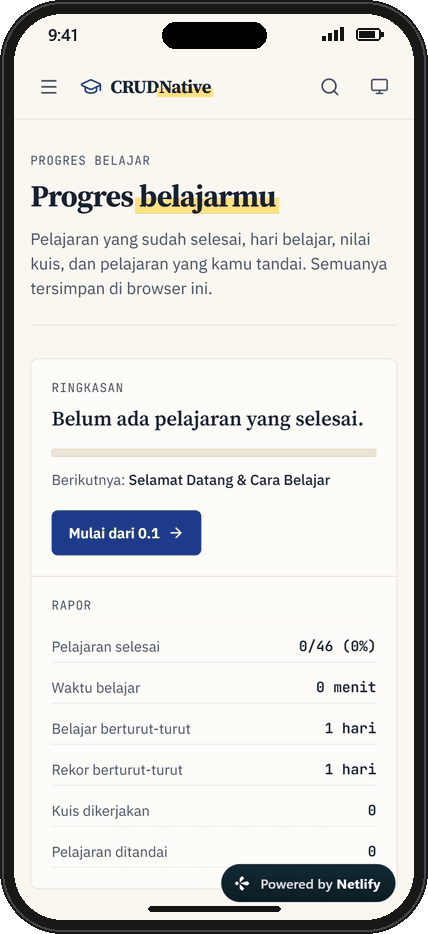 |

</details>

## 🗺️ Alur Belajar

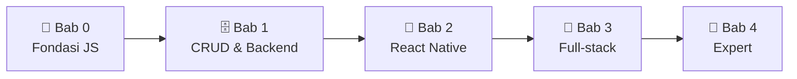

## 📚 Daftar Bab

<details>
<summary><b>🧱 Bab 0 · Fondasi Web & JavaScript</b></summary>

<br/>

Terminal, Node.js, JavaScript modern, async/await, Git, JSON.

</details>

<details>
<summary><b>🗄️ Bab 1 · CRUD & Backend dengan Express</b></summary>

<br/>

Konsep CRUD, HTTP & REST, SQL, relasi, Express, Prisma + SQLite, validasi, pagination.

</details>

<details>
<summary><b>📱 Bab 2 · React & React Native dengan Expo</b></summary>

<br/>

React dasar, state & effect, komponen inti, flexbox, FlatList, Expo Router, form, state global.

</details>

<details>
<summary><b>🔗 Bab 3 · Full-stack: CRUD Mobile + API</b></summary>

<br/>

Menyambungkan Expo ke API, create/read/update/delete, TanStack Query, upload gambar, login, capstone.

</details>

<details>
<summary><b>🚀 Bab 4 · Expert: Aplikasi Siap Dipakai Banyak Orang</b></summary>

<br/>

TypeScript end-to-end, arsitektur, keamanan API, performa, testing, offline-first, real-time, deploy & CI/CD.

</details>

## 📂 Struktur Repo

| Folder | Isi | Teknologi |
| --- | --- | --- |
| 🌐 [`web/`](web/README.md) | Situs belajar: materi, kuis, lab, cheatsheet, glosarium, progres | Next.js 16 (static export), Tailwind CSS v4, MDX |
| ⚙️ [`api/`](api/README.md) | API pendamping (opsional) untuk proyek latihan | Express 5, Prisma 7, SQLite, TypeScript, Zod, JWT |

> [!NOTE]
> Aplikasi Expo proyek latihan (`kuliah-app`) **tidak** disertakan di repo. Kamu membangunnya sendiri langkah demi langkah di Bab 2 dan Bab 3.

## ⚡ Mulai Cepat

> [!IMPORTANT]
> Butuh **Node.js 22.18+**.

**1️⃣ Situs belajar**

```powershell
cd web
npm install
npm run dev -- -p 3001   # buka http://localhost:3001
```

<details>
<summary><b>2️⃣ API pendamping (opsional, di terminal lain)</b></summary>

<br/>

```powershell
cd api
npm install
Copy-Item .env.example .env   # macOS/Linux: cp .env.example .env
npm run db:migrate
npm run db:seed
npm run dev                   # http://localhost:3000/api
```

</details>

## 🚀 Deploy ke Netlify

Pengaturan build sudah ada di [`netlify.toml`](netlify.toml), jadi tidak perlu isi manual.

1. Push repo ini ke GitHub.
2. Di Netlify pilih **Add new project → Import an existing project**, lalu pilih repo ini.
3. Tekan **Deploy**. Situs bisa dibuka di `https://nama-situs.netlify.app` (versi resmi: [crudnative.netlify.app](https://crudnative.netlify.app/)).

<details>
<summary><b>⚙️ Pengaturan yang dipakai otomatis</b></summary>

<br/>

| Pengaturan | Nilai |
| --- | --- |
| Base directory | `web` |
| Build command | `npm run build` |
| Publish directory | `web/out` |
| Node.js | 22 |

</details>

<details>
<summary><b>🌍 Domain sendiri & hosting lain</b></summary>

<br/>

- Tambahkan environment variable `SITE_URL` (contoh `https://belajar.domainmu.com`) supaya canonical, `sitemap.xml`, dan `robots.txt` memakai domain itu.
- Hasil `npm run build` ada di `web/out/` dan bisa di-hosting di layanan statis lain. Untuk GitHub Pages, lihat catatan `BASE_PATH` di [`web/README.md`](web/README.md).

</details>

> [!TIP]
> Yang di-deploy hanya `web/` (situs statis). API di `api/` butuh server Node.js sungguhan; cara deploy-nya dibahas di Bab 4.

## ✅ Perintah Pengecekan

| Folder | Perintah |
| --- | --- |
| `web` | `npm run typecheck` · `npm run lint` · `npm test` · `npm run check:content` · `npm run build` |
| `api` | `npm run typecheck` · `npm test` |

## 📜 Lisensi

- 💻 **Kode program**: [MIT](LICENSE)
- 📝 **Materi belajar** di `web/content/`: [CC BY 4.0](LICENSE-CONTENT.md). Boleh dipakai ulang asal menyebut sumbernya.

<div align="center">

<br/>

Dibuat dengan ❤️ untuk pemula Indonesia · ⭐ Beri bintang kalau bermanfaat!

</div>
